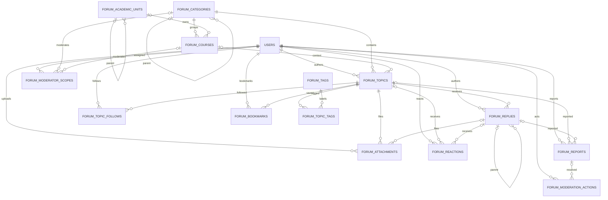

# Thiết kế tích hợp Study Forum vào FMESS-CMCU

**Ngày:** 02-11-2026  
**Phạm vi:** Tài liệu thiết kế, không thay đổi source, cấu hình hay database; không chạy SQL/migration và không cài package.  
**Nền tảng chính thức:** Repository BTL_CNPhanMem. Social Network hiện tại tiếp tục hoạt động; Forum là module nghiệp vụ mới trong cùng ứng dụng và cùng hệ thống tài khoản.

## Quy ước về bằng chứng

- **[SOURCE]**: xác nhận được từ mã nguồn/cấu hình hiện tại; không đồng nghĩa tính năng đã được kiểm thử đầy đủ.
- **[ĐỀ XUẤT]**: thiết kế mới, chưa được triển khai.
- **[CHƯA XÁC ĐỊNH]**: cần dữ liệu hoặc quyết định của chủ dự án; không suy đoán dữ liệu chính thức của Đại học CMC.

Chi tiết hiện trạng được ghi trong [báo cáo phân tích dự án](./ANALYSIS_EXISTING_PROJECT.md). Repository hiện không có module Forum độc lập hoặc dữ liệu chính thức về khoa, ngành, môn học để tham chiếu.

## 1. Mục tiêu và phạm vi

- **[SOURCE]** Ứng dụng hiện tại là Spring Boot monolith + React/Vite SPA, dùng Spring Security/JWT, Spring Data JPA và Microsoft SQL Server.
- **[ĐỀ XUẤT]** Bổ sung Study Forum trong cùng ứng dụng, dùng chung `USERS.user_id`, đăng nhập và phiên hiện tại. Forum có domain, API, UI và bảng riêng; không lưu Forum topic/reply trong `SOCIAL_POST` hoặc `GROUP_POSTS`.
- **[ĐỀ XUẤT]** Forum phục vụ nội dung học thuật: phân loại nội dung, hỏi đáp, thảo luận, chia sẻ tài liệu, theo dõi/lưu chủ đề và kiểm duyệt theo phạm vi.
- **[CHƯA XÁC ĐỊNH]** Quyền xem nội dung theo lớp/môn, việc tích hợp hệ thống học vụ, taxonomy chính thức, chính sách tài liệu và các tính năng bắt buộc cho phiên bản đầu.

### Phạm vi gợi ý cho phiên bản đầu

1. Danh mục và môn học do admin quản trị; không seed trước danh sách khoa/ngành/môn.
2. Topic có loại `QUESTION`, `DISCUSSION` hoặc `RESOURCE`; bài `RESOURCE` là nơi chia sẻ tài liệu học tập.
3. Reply có thể lồng một cấp/nhiều cấp theo yêu cầu đã chốt; chấp nhận câu trả lời cho topic dạng câu hỏi.
4. Tìm kiếm/lọc, tag, bookmark, follow, reaction, báo cáo và hàng đợi kiểm duyệt.
5. Upload riêng tư mặc định, xác minh quyền trên từng lần tải xuống.

Các lựa chọn ở trên là **[ĐỀ XUẤT]**, không phải đặc tả đã được chủ dự án duyệt.

## 2. Sơ đồ kiến trúc tổng thể

```text
Browser
  React 18 SPA
  ├── Social Network routes/pages hiện tại
  └── /forum/* (Forum pages/components mới)
        └── forumApi -> Axios client hiện tại (access JWT / refresh hiện tại)
                    │ HTTPS/REST
                    ▼
Spring Boot 3.3.4 monolith
  Spring Security + JWT + @CurrentUser
  ├── Social controllers/services/repositories (giữ nguyên)
  └── forum/
      ├── controller -> service -> repository -> entity/DTO
      ├── authorization theo owner / moderator scope / ADMIN
      ├── file policy + private download service
      └── tích hợp NotificationService hiện có
                    │ JPA / SQL Server dialect
                    ▼
Microsoft SQL Server hiện tại
  USERS và các bảng Social hiện tại (không đổi nghĩa)
  FORUM_* tables mới, FK tác giả tới USERS.user_id

Private file storage (đề xuất)
  storage key ngẫu nhiên, không public static URL
  metadata FORUM_ATTACHMENTS -> file bytes ngoài database
```

- **[SOURCE]** Axios client đã đính kèm JWT/refresh phiên; `SecurityConfig` mặc định yêu cầu xác thực cho request không được permit; `@CurrentUser` lấy user hiện tại. WebSocket/STOMP hiện phục vụ chủ yếu cho chat/presence/call.
- **[ĐỀ XUẤT]** Dùng REST cho Forum ban đầu. Chỉ mở rộng realtime nếu có yêu cầu nghiệp vụ rõ; Forum không dùng topic chat làm bus dữ liệu.
- **[CHƯA XÁC ĐỊNH]** Hạ tầng production, topology nhiều backend instance, object storage, antivirus và mức sẵn sàng của SQL Server.

## 3. Cấu trúc nghiệp vụ Forum

### Taxonomy linh hoạt

- **Danh mục Forum** là cấu trúc do admin tạo để nhóm nội dung (ví dụ cấu trúc phân cấp tổng quát), không mặc định tương đương khoa/môn học.
- **Đơn vị học thuật** lưu cây đơn vị linh hoạt với loại do quản trị viên cấu hình/chọn, chẳng hạn loại đơn vị cấp trên/cấp dưới; không tạo sẵn tên khoa hoặc ngành.
- **Môn học** là bản ghi quản trị viên nhập sau khi có dữ liệu xác nhận. Mã môn có thể chưa biết; thiết kế cho phép mã rỗng và yêu cầu unique khi có mã.
- **Topic** thuộc một danh mục và tùy chọn một môn học. Nếu có `course_id`, service xác nhận môn học đang hoạt động và taxonomy phù hợp.
- **Tag** là nhãn chuẩn hóa do admin quản lý theo đề xuất; topic có nhiều tag. Nếu muốn moderator tạo tag, cần bổ sung quyền scope tương ứng.

**[CHƯA XÁC ĐỊNH]** Tên, mã, cây phân cấp và quan hệ chính thức của khoa/ngành/môn học, cũng như nguồn đồng bộ học vụ. Không tạo bản ghi mẫu được trình bày như dữ liệu chính thức CMC.

### Loại nội dung và vòng đời

- `QUESTION`: có câu trả lời và tùy chọn câu trả lời được chấp nhận.
- `DISCUSSION`: trao đổi mở; có reply và reaction.
- `RESOURCE`: chia sẻ học liệu; hỗ trợ metadata file, mô tả và thảo luận.
- Topic/reply do người dùng tạo được lưu là `PUBLISHED` hoặc trạng thái đã chốt. Nội dung bị xóa/ẩn nên giữ trạng thái soft-delete để bảo toàn liên kết, moderation và notification.
- Khóa topic ngăn reply/reaction mới nhưng không xóa nội dung; ẩn nội dung không cho người dùng thông thường đọc.
- **[CHƯA XÁC ĐỊNH]** Có cho phép draft, anonymous posting, sửa nội dung sau thời hạn, reply lồng nhiều cấp, vote/downvote, reaction loại nào, và ai có quyền chấp nhận câu trả lời.

## 4. ERD đề xuất



Trong ERD, `o|` thể hiện quan hệ tùy chọn. Các quan hệ polymorphic không dùng trong thiết kế này: reaction/report/attachment có hai FK nullable nhưng có CHECK constraint buộc đúng một FK target được đặt. Điều đó giữ được FK SQL Server tới topic/reply.

## 5. Danh sách bảng SQL Server dự kiến

Tên và kiểu dưới đây là **[ĐỀ XUẤT]**, không phải DDL để chạy. Dùng `BIGINT IDENTITY` cho khóa surrogate, `NVARCHAR` cho nội dung Unicode, `DATETIME2` cho thời gian; lưu timestamp UTC nhất quán. Hạn chế cascade delete trên nội dung/metadata; dùng trạng thái soft-delete và xử lý xóa có chủ đích.

Quy ước audit: bảng nghiệp vụ nên có `created_at`, `updated_at` khi cần; `created_by`/`updated_by` là FK tới `USERS.user_id` nếu có ý nghĩa chỉnh sửa. Các bảng liên kết thường dùng thời điểm tạo thay cho `updated_at`.

| Bảng dự kiến | Trường/quan hệ chính | PK, FK, unique/check/index đề xuất | Mục đích |
|---|---|---|---|
| `FORUM_ACADEMIC_UNITS` | `unit_id`, `parent_unit_id` nullable, `unit_type`, `code` nullable, `name`, `description`, `status`, audit | PK `unit_id`; self-FK `parent_unit_id`; FK creator/updater -> `USERS`; filtered unique index trên `code` khi not null; index `(parent_unit_id,status)` | Cây đơn vị học thuật linh hoạt; không seed dữ liệu chưa xác thực. |
| `FORUM_CATEGORIES` | `category_id`, `parent_category_id` nullable, `name`, `slug`, `description`, `sort_order`, `status`, audit | PK; self-FK; FK creator/updater -> USERS; unique `slug`; index `(parent_category_id,status,sort_order)` | Danh mục thảo luận quản trị được, độc lập với taxonomy học vụ. |
| `FORUM_COURSES` | `course_id`, `category_id`, `unit_id` nullable, `course_code` nullable, `name`, `description`, `status`, audit | PK; FK category required; FK unit nullable; FK audit -> USERS; filtered unique `(course_code)` khi có mã; index `(category_id,status)` và `(unit_id,status)` | Môn học do quản trị viên nhập sau khi có nguồn xác nhận. |
| `FORUM_TAGS` | `tag_id`, `name`, `slug`, `description`, `status`, creator/time | PK; FK creator -> USERS; unique `slug`; index `(status,name)` | Từ khóa chuẩn hóa để lọc nội dung. |
| `FORUM_TOPICS` | `topic_id`, `category_id`, `course_id` nullable, `author_id`, `topic_type`, `title`, `body`, `status`, `pinned`, view/count fields nếu cần, audit | PK; FK category/course/author/audit; index `(category_id,status,created_at DESC)`, `(course_id,status,created_at DESC)`, `(author_id,created_at DESC)`; index/filter slug/title nếu search strategy yêu cầu | Chủ đề chính của Forum; không dùng SOCIAL_POST/GROUP_POSTS. |
| `FORUM_REPLIES` | `reply_id`, `topic_id`, `parent_reply_id` nullable, `author_id`, `body`, `status`, `is_accepted`, `accepted_at`, audit | PK; FK topic, self-FK parent, author/audit -> USERS; filtered unique index `topic_id WHERE is_accepted=1` để tối đa một câu trả lời accepted/topic; index `(topic_id,status,created_at)` | Trả lời và phản hồi; accepted chỉ hợp lệ cho `QUESTION`, cần service kiểm tra. |
| `FORUM_TOPIC_TAGS` | `topic_id`, `tag_id`, `created_at`, `created_by` | PK ghép `(topic_id,tag_id)`; FK cả hai bảng và creator -> USERS; index `(tag_id,topic_id)` | Quan hệ N-N topic/tag. |
| `FORUM_ATTACHMENTS` | `attachment_id`, `topic_id` nullable, `reply_id` nullable, `uploaded_by`, `storage_key`, `original_file_name`, `extension`, `detected_content_type`, `size_bytes`, `sha256` nullable, `scan_status`, `status`, `created_at` | PK; FK target/topic/reply/uploader; CHECK đúng một trong `topic_id`,`reply_id`; unique `storage_key`; index `(topic_id,status)`, `(reply_id,status)`, `(uploaded_by,created_at)` | Metadata file; bytes nằm trong private file storage, không lưu binary/URL public trong bảng. |
| `FORUM_TOPIC_FOLLOWS` | `topic_id`, `user_id`, `created_at` | PK ghép `(topic_id,user_id)`; FK topic/user; index `(user_id,created_at)` | Theo dõi để nhận notification. |
| `FORUM_BOOKMARKS` | `topic_id`, `user_id`, `created_at` | PK ghép `(topic_id,user_id)`; FK topic/user; index `(user_id,created_at)` | Lưu chủ đề riêng của người dùng, giữ FK thật thay vì polymorphic `SAVED_ITEMS`. |
| `FORUM_REACTIONS` | `reaction_id`, `topic_id` nullable, `reply_id` nullable, `user_id`, `reaction_type`, `created_at` | PK; FK targets/user; CHECK đúng một target; filtered unique `(topic_id,user_id)` khi topic not null và `(reply_id,user_id)` khi reply not null; index theo target | Reaction kiểu đơn giản (ví dụ LIKE/HELPFUL sau khi duyệt); một reaction/user/target, đổi loại bằng update. |
| `FORUM_REPORTS` | `report_id`, `topic_id` nullable, `reply_id` nullable, `reporter_id`, `reason_code`, `details`, `status`, `assigned_to` nullable, `resolution_note`, `created_at`, `resolved_at` | PK; FK targets/reporter/assignee -> USERS; CHECK đúng một target; index `(status,created_at)`, `(assigned_to,status)`, target columns | Báo cáo nội dung và hàng đợi xử lý; service giới hạn báo trùng đang mở. |
| `FORUM_MODERATOR_SCOPES` | `scope_id`, `user_id`, `category_id` nullable, `course_id` nullable, `granted_by`, `status`, `created_at`, `revoked_at` | PK; FK user/grantor/category/course -> USERS/các bảng tương ứng; CHECK tối đa một scope target (cả hai null = global; đúng một = scoped); filtered unique indexes cho global/user, category/user, course/user khi active | Gán moderator toàn Forum hoặc theo category/course; không thêm global role vào `Role` nếu chưa được duyệt. |
| `FORUM_MODERATION_ACTIONS` | `action_id`, `actor_id`, `topic_id` nullable, `reply_id` nullable, `report_id` nullable, `action_type`, `reason`, `created_at` | PK; FK actor/targets/report; CHECK target phù hợp; index `(topic_id,created_at)`, `(reply_id,created_at)`, `(report_id,created_at)` | Audit thao tác ẩn/khóa/khôi phục/xử lý report và phân công moderator. |

### Constraints và hành vi cần thống nhất

- FK tác giả, actor, reporter, người duyệt và người upload tới `USERS.user_id`; không có `FORUM_USERS`.
- `status`, `topic_type`, `scan_status`, `reason_code` cần enum/lookup contract rõ. Có thể lưu `VARCHAR` có CHECK hoặc lookup table; không chọn mã nghiệp vụ chưa được duyệt.
- Topic `course_id` có thể null để hỗ trợ danh mục chưa gắn môn; không ép mọi nội dung thuộc môn học.
- Service phải xác minh `course.category_id` trùng category topic; FK thông thường không thể đảm bảo điều kiện liên bảng này.
- Reply `parent_reply_id` phải thuộc cùng `topic_id`; accepted reply phải thuộc topic được chấp nhận. Đây là invariant cần validate trong transaction/service.
- SQL Server filtered unique index là đề xuất cho constraint có điều kiện; DDL triển khai phải được kiểm tra trên đúng phiên bản SQL Server được xác nhận.
- Không thêm bảng danh sách khoa/môn đã điền sẵn cho tới khi nhận nguồn dữ liệu chính thức.

**[SOURCE]** `SAVED_ITEMS` hiện có `content_type/content_id` nhưng không có FK đa hình tới nội dung; `APP_NOTIFICATION` dùng `reference_type/reference_id` cũng không có FK đa hình.  
**[ĐỀ XUẤT]** Dùng bảng bookmark/follow Forum có FK rõ; notification có thể ghi vào `APP_NOTIFICATION` hiện tại với reference type Forum, không tạo account/notification system riêng.  
**[CHƯA XÁC ĐỊNH]** Có cần tích hợp Forum bookmark vào màn hình Saved chung hay giữ danh sách lưu riêng; quyết định này ảnh hưởng UI/API, không cần gộp bảng ngay.

## 6. API đề xuất

Base path: `/api/forum`. Request/response là JSON trừ endpoint upload. Các endpoint bên dưới là **[ĐỀ XUẤT]**, không tồn tại trong source hiện tại. Quyền luôn được kiểm tra lại trong backend theo bản ghi/scope; frontend guard chỉ phục vụ UX.

### Đọc taxonomy, home và tìm kiếm

| Method + endpoint | Mục đích / request chính | Response chính | Quyền |
|---|---|---|---|
| `GET /home` | Tổng hợp danh mục, môn học nổi bật/được truy cập gần đây, topic mới/nổi bật; query phân trang | `categories`, `courses`, `recentTopics`, `popularTopics` | USER |
| `GET /categories` | Danh sách cây danh mục; query `parentId`, `status` | danh sách category DTO | USER; chỉ trả category active với USER |
| `GET /categories/{categoryId}` | Chi tiết category và summary | category + course/topic counts | USER |
| `GET /academic-units` | Duyệt cây đơn vị; query `parentId`, `unitType` | cây/danh sách unit | USER |
| `GET /courses` | Lọc `categoryId`, `unitId`, `q`, `page`, `size` | page course DTO | USER |
| `GET /courses/{courseId}` | Chi tiết môn, danh sách topic phân trang | course DTO + summary/topics | USER |
| `GET /topics` | Search/filter `q`, `categoryId`, `courseId`, `tag`, `type`, `sort`, `page`, `size` | `Page<TopicSummaryResponse>` | USER; chỉ nội dung được phép xem |
| `GET /search` | Tìm topic, môn học, tag; `q` bắt buộc, page/size | nhóm kết quả phân trang | USER; áp authorization filter trước khi trả kết quả |

### Quản lý taxonomy và tag

| Method + endpoint | Mục đích / request chính | Response chính | Quyền |
|---|---|---|---|
| `POST /admin/categories`, `PATCH /admin/categories/{id}` | Tạo/cập nhật `name`, `slug`, `description`, `parentId`, `status`, `sortOrder` | category DTO | ADMIN |
| `POST /admin/academic-units`, `PATCH /admin/academic-units/{id}` | Quản trị cây đơn vị; `unitType`, `parentUnitId`, `name`, optional `code` | unit DTO | ADMIN |
| `POST /admin/courses`, `PATCH /admin/courses/{id}` | Tạo/cập nhật `name`, optional `courseCode`, `categoryId`, optional `unitId`, `status` | course DTO | ADMIN |
| `POST /admin/tags`, `PATCH /admin/tags/{id}` | Quản trị tag `name`, `slug`, trạng thái | tag DTO | ADMIN |
| `POST /admin/moderator-scopes` | Gán user moderator; `userId`, một trong `categoryId/courseId` hoặc không scope | assignment DTO | ADMIN |
| `DELETE /admin/moderator-scopes/{scopeId}` | Thu hồi assignment (soft revoke/audit) | `204` | ADMIN |

### Topic, reply và tương tác

| Method + endpoint | Mục đích / request chính | Response chính | Quyền |
|---|---|---|---|
| `POST /topics` | Tạo topic: `categoryId`, optional `courseId`, `type`, `title`, `body`, `tagIds` | topic DTO + IDs | USER |
| `GET /topics/{topicId}` | Đọc topic, tag, attachment metadata, reply page và interaction state | topic detail DTO | USER; service kiểm tra access và status |
| `PATCH /topics/{topicId}` | Sửa title/body/category/course/tags trong giới hạn policy | topic DTO | tác giả; scoped moderator nếu kiểm duyệt |
| `DELETE /topics/{topicId}` | Soft-delete, không xóa row/file ngay | `204` | tác giả theo policy; moderator/admin |
| `POST /topics/{topicId}/replies` | Tạo reply: `body`, optional `parentReplyId` | reply DTO | USER nếu topic mở |
| `PATCH /replies/{replyId}` | Chỉnh nội dung | reply DTO | tác giả hoặc moderator scope |
| `DELETE /replies/{replyId}` | Soft-delete reply | `204` | tác giả theo policy; moderator/admin |
| `PUT /topics/{topicId}/accepted-answer/{replyId}` | Chấp nhận câu trả lời; service xác nhận topic là QUESTION và reply thuộc topic | topic/reply summary | tác giả topic hoặc moderator scope; ADMIN |
| `DELETE /topics/{topicId}/accepted-answer` | Gỡ accepted answer | `204` | người có quyền chấp nhận |
| `PUT /topics/{topicId}/follow` / `DELETE ...` | Theo dõi/bỏ theo dõi | follow state hoặc `204` | USER |
| `PUT /topics/{topicId}/bookmark` / `DELETE ...` | Lưu/bỏ lưu topic | bookmark state hoặc `204` | USER |
| `PUT /topics/{topicId}/reaction` / `PUT /replies/{replyId}/reaction` | Tạo/cập nhật reaction; body `{ "type": "..." }` | reaction summary/counts | USER |
| `DELETE /topics/{topicId}/reaction` / `DELETE /replies/{replyId}/reaction` | Gỡ reaction hiện tại | `204` | chủ reaction (authenticated user) |

### Attachment, report và moderation

| Method + endpoint | Mục đích / request chính | Response chính | Quyền |
|---|---|---|---|
| `POST /topics/{topicId}/attachments` | Multipart `file`; upload file vào quarantine và gắn topic | metadata DTO, không trả direct public URL | tác giả topic/scoped moderator |
| `POST /replies/{replyId}/attachments` | Multipart `file`; gắn file vào reply | metadata DTO | tác giả reply/scoped moderator |
| `GET /attachments/{attachmentId}/download` | Kiểm tra topic/reply status và quyền đọc, stream file | bytes + safe `Content-Disposition` | USER có quyền đọc target |
| `DELETE /attachments/{attachmentId}` | Đánh dấu unavailable; cleanup bytes theo retention policy | `204` | chủ nội dung hoặc moderator/admin |
| `POST /topics/{id}/reports`, `POST /replies/{id}/reports` | Report `reasonCode`, `details` | report summary | USER; không report nội dung của chính mình nếu policy xác nhận |
| `GET /moderation/reports` | Queue lọc status/category/course/date/page | report DTO page | ADMIN hoặc moderator được gán scope |
| `PATCH /moderation/reports/{id}` | Assign/resolve/dismiss; request status, note/action | report/action DTO | ADMIN hoặc moderator scope đúng target |
| `PATCH /moderation/topics/{id}` | Ẩn/khôi phục/khóa/mở khóa; request action + reason | topic moderation DTO | ADMIN hoặc scoped moderator |
| `PATCH /moderation/replies/{id}` | Ẩn/khôi phục; request action + reason | reply moderation DTO | ADMIN hoặc scoped moderator |

Error contract nên dùng `ApiException`/`GlobalExceptionHandler` hiện có: 400 validation, 401 unauthenticated, 403 forbidden, 404 resource không tồn tại/không được phép lộ, 409 conflict. Quy ước tránh IDOR và việc response tiết lộ tài nguyên private cần được thống nhất.

Attachment DTO trong topic/reply detail nên trả `attachmentId`, tên file gốc đã làm sạch, định dạng, dung lượng bytes, người tải lên (user ID/tên hiển thị/avatar theo privacy policy), thời điểm tải lên, scan/status và endpoint tải xuống có xác thực. Không trả `storage_key`, đường dẫn máy chủ hay public URL. **[ĐỀ XUẤT]**

## 7. Cấu trúc package backend

**[SOURCE]** Backend hiện tổ chức controller/service/repository/entity/DTO theo convention trong `com.example.messaging`.  
**[ĐỀ XUẤT]** Tạo package feature riêng, vẫn ở trong Spring Boot monolith:

```text
com.example.messaging.forum
├── controller
│   ├── ForumHomeController
│   ├── ForumTaxonomyController
│   ├── ForumTopicController
│   ├── ForumReplyController
│   ├── ForumAttachmentController
│   └── ForumModerationController
├── service
│   ├── ForumAuthorizationService
│   ├── ForumTopicService
│   ├── ForumReplyService
│   ├── ForumTaxonomyService
│   ├── ForumAttachmentService
│   ├── ForumReportService
│   └── ForumNotificationService
├── repository
├── entity
├── dto
│   ├── request
│   └── response
├── validation
└── storage
```

- **Entity:** quan hệ FK thật, không trả entity trực tiếp trong controller. Giữ authorization-sensitive query và status rõ ràng.
- **Repository:** query phân trang và query moderation; tránh tải toàn bộ topic/reply hoặc collection quan hệ.
- **DTO:** request có Jakarta Validation; response chỉ chứa metadata được phép xem, không expose storage path/key nội bộ.
- **Service:** transaction boundary, kiểm tra trạng thái/ownership/scope, cross-row invariant, audit, notification.
- **Controller:** HTTP mapping, `@CurrentUser`, `@Valid`, multipart boundary; không tự làm business rule.
- **Validation:** giới hạn title/body/tag count, quan hệ course-category, loại file và scope assignment. Limits cụ thể cần chốt.
- **Security/Authorization:** dùng JWT hiện có; `ForumAuthorizationService` xác nhận `Role.ADMIN` hoặc moderator assignment đang active và bao phủ target category/course. `USER` là quyền cơ sở; không dựa vào route guard.
- **Exception:** dùng `ApiException` và global handler hiện tại; thêm mã lỗi/domain details nếu API contract cần, không tạo fallback im lặng.
- **Notification:** gọi/tích hợp `NotificationService` hiện có sau khi xác định recipient, event và transaction semantics.
- **File storage:** tạo abstraction riêng cho private document lifecycle thay vì phục vụ tài liệu qua `/uploads/{fileName}` đang public route.

Không khuyến nghị tạo package `forum` tách thành service/deployment riêng ở giai đoạn này; không có bằng chứng hiện tại yêu cầu microservice.

## 8. Cấu trúc và giao diện frontend

**[SOURCE]** React Router hiện được định nghĩa trong `App.jsx`, các trang nghiệp vụ dùng `MainLayout`; `AppTopBar`, `NavRail`, CSS theo feature, Axios API modules và `AuthContext` có thể tái sử dụng. TopBar global search hiện tìm người/nhóm, không phải Forum.

**[ĐỀ XUẤT]** Giữ social pages và thêm feature module:

```text
frontend/src/
├── api/forumApi.js
├── pages/forum/
│   ├── ForumLayout.jsx
│   ├── ForumHomePage.jsx
│   ├── ForumCategoryPage.jsx
│   ├── ForumCoursePage.jsx
│   ├── ForumTopicListPage.jsx
│   ├── ForumTopicDetailPage.jsx
│   ├── ForumCreateTopicPage.jsx
│   ├── ForumShareResourcePage.jsx
│   ├── ForumSearchPage.jsx
│   ├── ForumAdminPage.jsx
│   └── ForumModerationPage.jsx
├── components/forum/
│   ├── CategoryTree.jsx
│   ├── CourseHeader.jsx
│   ├── TopicCard.jsx
│   ├── TopicTypeBadge.jsx
│   ├── ReplyThread.jsx
│   ├── AttachmentList.jsx
│   ├── AttachmentUploader.jsx
│   ├── ForumFilters.jsx
│   └── ReportDialog.jsx
└── styles/forum.css
```

### Routing tích hợp

Các route đề xuất nằm dưới protected route/layout hiện tại:

```text
/forum
/forum/categories/:categoryId
/forum/courses/:courseId
/forum/topics
/forum/topics/new
/forum/topics/new?type=RESOURCE
/forum/topics/:topicId
/forum/search
/forum/admin
/forum/moderation
```

- Giữ `AuthProvider`, `ProtectedRoute` và `MainLayout`; không thay route hiện tại.
- Tạo `ForumLayout` trong nested route để có sidebar điều hướng riêng (danh mục, môn gần đây, theo dõi), nhưng vẫn dùng AppTopBar toàn cục.
- Khi tích hợp, cập nhật nhận diện route trong `MainLayout` để `/forum/*` dùng shell Forum, không vô tình hiển thị Sidebar chat hoặc dùng nhầm shell feed.
- Thêm link Forum riêng vào navigation có sẵn (`AppTopBar`/`NavRail`) với nhãn rõ; giữ link feed/social hiện tại và trạng thái active chính xác cho các route lồng.
- Search Forum nằm trong Forum UI hoặc chuyển đến `/forum/search?q=...`; không đổi ý nghĩa global search hiện tại nếu chưa thống nhất.
- `ForumAdminPage` và `ForumModerationPage` có route guard UX; backend vẫn xác thực mọi API.

### Hướng giao diện

- **[ĐỀ XUẤT]** Phong cách học thuật hiện đại: hierarchy rõ, typography dễ đọc, ưu tiên tiêu đề/tags/môn học/loại topic/trạng thái giải đáp; layout hai cột khi đủ rộng, responsive trên thiết bị nhỏ.
- Forum home tập trung vào danh mục, môn học, câu hỏi chưa trả lời, tài liệu mới và nội dung đang theo dõi; không lấy news feed làm bố cục mặc định.
- Topic detail thể hiện câu hỏi/đáp án, tài liệu có metadata và luồng phản hồi; có trạng thái khóa/ẩn và action rõ ràng.
- Tái sử dụng design tokens, Avatar, Loading/Error/Empty states; tạo component/style Forum riêng. Không sao chép bố cục Facebook.
- **[CHƯA XÁC ĐỊNH]** Brand guideline, màu chủ đạo của trường, khả năng tiếp cận mục tiêu và mức ưu tiên mobile.

## 9. Ma trận phân quyền

`MODERATOR` được hiểu là assignment có scope trong Forum, không phải role global hiện có. **[SOURCE]** Global enum hiện chỉ có `USER` và `ADMIN`. **[ĐỀ XUẤT]** Admin global được nhận diện bằng `Role.ADMIN`; moderator được cấp thông qua `FORUM_MODERATOR_SCOPES`; user authenticated không có assignment là USER. Mọi thay đổi/đọc nội dung phải xác minh ở backend.

| Nghiệp vụ | USER | MODERATOR (scope được gán) | ADMIN (toàn hệ thống) |
|---|---|---|---|
| Đọc category/course/topic active | Có nếu qua policy xem | Có; có thể xem thêm queue scope | Có |
| Tạo topic/reply/upload | Có theo policy, nếu topic mở | Có như USER; quản trị nội dung trong scope | Có |
| Sửa/xóa nội dung | Nội dung của mình theo policy; soft-delete | Nội dung trong scope; ghi audit | Toàn Forum; ghi audit |
| Khóa/ẩn/khôi phục topic/reply | Không | Chỉ category/course được gán | Toàn Forum |
| Chấp nhận câu trả lời | Tác giả topic (nếu QUESTION) | Scope moderator nếu policy cho phép | Có |
| Bookmark/follow/reaction/report | Nội dung được xem | Như USER | Như USER |
| Xem report queue và xử lý | Xem report do mình gửi nếu có API | Chỉ report thuộc scope; assign/resolve theo policy | Toàn bộ, assign moderator |
| Quản lý category/unit/course/tag | Không | Không theo mặc định | Có |
| Gán/thu hồi moderator | Không | Không | Có |
| Xem/moderate nội dung private | Chỉ nếu được policy cho phép | Chỉ scope + access policy | Có theo chính sách audit |

### Quy tắc bắt buộc

1. Không tin `userId`, `role`, `categoryId`, `courseId` từ body để xác nhận identity; lấy user từ `@CurrentUser`/SecurityContext.
2. Check role/scope và quyền đọc file trong service cho từng request; không chỉ check ở controller hoặc frontend.
3. Moderator assignment phải active, scope phải bao phủ target, và thao tác moderation phải lưu actor/reason/time.
4. Nếu resource ẩn/private, API, search, counts, attachment metadata và download không được rò rỉ cho user ngoài quyền.
5. Course enrollment hiện không có trong source; không áp dụng giả định “chỉ sinh viên đăng ký môn mới được xem”. Trước khi tích hợp enrollment, policy mặc định cần chủ dự án duyệt.
6. Đề xuất mặc định cho MVP: mọi thao tác Forum yêu cầu đăng nhập; topic active có thể xem bởi user đăng nhập theo category policy. Nếu muốn truy cập công khai, phải thiết kế allowlist endpoint và kiểm tra CORS/cache riêng.

## 10. Quy trình upload/download an toàn

**[SOURCE]** Upload hiện dùng filesystem local; `FileStorageService` có giới hạn mặc định, group có extension/MIME allowlist, multipart global cho phép request lớn; `/uploads/**` được permit trong security config. Đây không phải nền tảng đủ an toàn để mặc định dùng URL công khai cho học liệu Forum.

**[ĐỀ XUẤT]** Quy trình:

1. **Authorize upload:** authenticated user; xác nhận user được tạo/sửa target topic/reply và target chưa khóa/ẩn.
2. **Giới hạn request:** giới hạn số file, bytes/file và tổng bytes/request; giá trị cấu hình theo quyết định chủ dự án, không lấy trần 200MB hiện tại làm policy Forum.
3. **Allowlist format:** PDF, DOC/DOCX, PPT/PPTX, XLS/XLSX và định dạng bổ sung chỉ sau khi duyệt. Kiểm tra extension, MIME phát hiện từ nội dung/magic bytes và cấu trúc file; không tin tên file hoặc `Content-Type` do client gửi.
4. **Tên lưu an toàn:** sinh storage key UUID/random, chuẩn hóa và giới hạn tên gốc chỉ là metadata hiển thị; chống traversal, archive bomb và file thực thi.
5. **Quarantine:** ghi file vào private temp/quarantine; trạng thái metadata `PENDING_SCAN`. Chỉ công bố tải xuống sau khi bước antivirus/content inspection (nếu hạ tầng được duyệt) xác nhận file hợp lệ. Hiện chưa thấy malware scanning trong source.
6. **Gắn metadata:** lưu `FORUM_ATTACHMENTS`, uploader, target FK, size, detected type, scan/status; không lưu filesystem path hoặc URL public cho frontend. Xử lý cleanup file nếu DB transaction thất bại.
7. **Download có kiểm tra:** `GET /api/forum/attachments/{id}/download` xác thực JWT, nạp attachment bằng ID, kiểm tra status, trạng thái target, quyền đọc category/course và file available. ID không thay thế authorization.
8. **Stream an toàn:** đọc storage key do server quản lý, không nhận filesystem path từ request; response `Content-Disposition: attachment`, MIME an toàn, `X-Content-Type-Options: nosniff`, cache private/no-store khi phù hợp. Hạn chế inline rendering.
9. **Xóa và retention:** khi attachment bị detach/xóa, đánh dấu trạng thái và cleanup bytes theo retention; soft-delete nội dung không làm xóa file ngay nếu còn cần moderation/audit.
10. **Vận hành:** quota theo user/course, rate limits, giới hạn download, backup/restore và theo dõi dung lượng. Với nhiều backend instance cần storage dùng chung hoặc object storage riêng tư; không giả định local disk chia sẻ.

**[CHƯA XÁC ĐỊNH]** Dung lượng tối đa, quota, antivirus service, storage backend, retention, quyền tải học liệu, chính sách bản quyền và có cho phép preview file trong browser hay không.

## 11. Chiến lược migration và bảo vệ dữ liệu cũ

### Hiện trạng liên quan

- **[SOURCE]** `application.yml` đặt `spring.jpa.hibernate.ddl-auto: update` và `spring.sql.init.mode: always` với các script `ensure-*.sql`.
- **[SOURCE]** Có SQL scripts thủ công/legacy; `backend/database/schema.sql` chứa `DROP TABLE` và không đồng bộ đầy đủ với entity hiện tại. Không dùng schema script này làm migration cho môi trường có dữ liệu.
- **[CHƯA XÁC ĐỊNH]** Schema thực tế, dữ liệu, lịch sử script đã chạy và người sở hữu quy trình deploy database; chưa kết nối SQL Server.

### Quy trình an toàn đề xuất — phải được duyệt trước khi triển khai

1. **Inventory/read-only:** lấy schema snapshot từ từng môi trường (bảng, cột, FK, index, collation, phiên bản SQL Server), đối chiếu `@Entity`, scripts và cấu hình. Không chạy script để “xem thử”.
2. **Backup/restore proof:** backup đầy đủ trước thay đổi; kiểm tra có thể restore vào môi trường cô lập và xác nhận dữ liệu social quan trọng.
3. **Chọn schema owner:** quyết định quy trình migration duy nhất. Khuyến nghị migration versioned/reviewed (ví dụ Flyway nếu được duyệt và chấp thuận dependency/config bổ sung); phương án thay thế là SQL Server scripts đánh số phiên bản có bảng lịch sử, checksum và quy trình chạy thủ công được kiểm soát. Đây là lựa chọn cần phê duyệt; hiện repository chưa có Flyway/Liquibase.
4. **Giải quyết startup DDL trước khi thêm Forum:** `ddl-auto=update` có thể tự sửa/tạo bảng từ entity Forum; `sql.init.mode=always` chạy script mỗi lần khởi động. Trước khi triển khai schema Forum, đánh giá cách chuyển quyền tạo schema sang migration có kiểm soát, đồng thời xác nhận các module hiện tại vẫn khởi động được. Cần thay đổi cấu hình ở một giai đoạn sau với phê duyệt rõ; tài liệu này không thay đổi cấu hình.
5. **Không auto-apply Forum DDL khi khởi động:** không đặt migration Forum vào script ensure tự chạy theo startup nếu chưa có versioning, review, backup và kiểm thử môi trường.
6. **Thiết kế additive:** chỉ tạo bảng/index `FORUM_*` và FK tham chiếu `USERS`; không rename/drop/alter dữ liệu Social; không sửa nội dung hoặc nghĩa cột hiện tại.
7. **Review SQL Server:** kiểm tra cú pháp, FK, filtered indexes, nullability, lock/time, index plan, default/UTC và rollback trên đúng phiên bản SQL Server.
8. **Apply theo môi trường:** chạy migration trên clone/QA trước; kiểm tra startup Hibernate và toàn bộ regression; sau khi ký duyệt mới schedule production migration.
9. **Rollback có nguyên tắc:** ưu tiên forward-fix. Reversal destructive chỉ khi backup đã xác nhận và owner chấp thuận; không xóa bảng có dữ liệu như rollback mặc định. Migration thêm cột/bảng nên tương thích code cũ trong giai đoạn rollout.
10. **Ghi nhận:** mỗi migration có version/checksum, ticket/reviewer, precondition, kết quả, thời gian, backup reference và phương án khôi phục.

### Bảo vệ Social Network

- Không chạy `backend/database/schema.sql` trong quá trình Forum; script có `DROP TABLE`.
- Forum tables có namespace riêng; không chỉnh sửa/xóa Social table hay sửa entity Social để dùng chung bảng.
- Trước/sau migration so sánh schema và smoke-test auth, feed, groups, chat, saved, events, notifications, admin.
- Không dùng schema state suy ra từ local files làm bằng chứng database production.

## 12. Quy trình thông báo

- **[SOURCE]** Có `APP_NOTIFICATION`, `NotificationService`, API list/unread/read/delete; TopBar hiện polling số chưa đọc định kỳ. Chưa thấy Web Push service.
- **[ĐỀ XUẤT]** Ghi notification Forum vào hệ thống hiện có bằng `type`, `reference_type` (ví dụ `FORUM_TOPIC`/`FORUM_REPLY`) và `reference_id`; không tạo account hoặc notification table song song.
- Sự kiện MVP: reply mới vào topic đang theo dõi, reply trực tiếp vào bài của user, accepted answer, kết quả report quan trọng/moderation action nếu policy cho phép.
- Không tự thông báo người thực hiện hành động; chặn notification trùng theo cặp actor/event/target; không tiết lộ nội dung private trong message preview.
- Sau khi persist topic/reply thành công, xác định recipients có quyền xem target rồi tạo notification. Ghi notification trong cùng transaction khi fan-out nhỏ và semantics phù hợp.
- Nếu follower count cao hoặc gửi bất đồng bộ, cân nhắc outbox/job có idempotency; hiện source không thể hiện queue/outbox, nên đây là việc mới, không giả định có sẵn.
- Frontend có thể tái dùng `/api/notifications`; thêm deep-link target Forum và cập nhật trạng thái unread qua event hiện có hoặc polling. Không sửa hành vi notification Social ở bước thiết kế.
- **[CHƯA XÁC ĐỊNH]** Sự kiện nào bắt buộc thông báo, preference/mute/digest, email, push, SLA và chính sách chống spam notification.

## 13. Kế hoạch kiểm thử

| Lớp | Kiểm thử cần có |
|---|---|
| Domain/unit | Chuyển trạng thái topic/reply; soft delete; course-category consistency; accepted answer chỉ cho QUESTION; moderator scope; hạn chế tự report/duplicate; notification không gửi cho actor. |
| Repository/SQL Server | Constraints/FK/check/filtered unique indexes; truy vấn phân trang/sort; duplicate topic tags; xóa/revoke assignment; chạy trên SQL Server thật hoặc test instance tương thích, không chỉ H2. |
| Security/API | USER không truy cập moderation/admin; moderator scope không vượt category/course; ADMIN global; IDOR trên topic/reply/attachment/report; 401/403/404 contract; request validation. |
| File security | Extension/MIME mismatch, signature, zero/oversized file, traversal filename, archive bomb, duplicate, scan states, unauthorized download, hidden/locked/deleted target, path disclosure, cleanup DB failure. |
| Notification | Recipient đúng, follower access filter, không self-notify, deduplication, transaction/error behavior, deep-link hoạt động, unread count. |
| Frontend | Router/guard, create/edit/reply, search/filter/page, optimistic state/error handling, upload progress/failure/retry, accessible forms/dialogs, responsive view. |
| Regression Social | Auth/refresh, feed/privacy, groups/moderation, chat/WebSocket, saved, event, notifications, video, admin không bị thay đổi. |
| Migration/ops | Restore backup, migration trên clone SQL Server, startup nhiều cấu hình, schema diff, rollout phiên bản code cũ/mới, rollback/forward-fix rehearsal. |

**[SOURCE]** Báo cáo giai đoạn 1 tìm thấy ba test class backend và không thấy frontend test script; độ bao phủ hiện tại của các module khác chưa xác định.  
**[ĐỀ XUẤT]** Trước khi triển khai, bổ sung test theo các lớp trên; test quyền và file phải chạy ở API/service boundary thực tế, không chỉ kiểm tra UI.

## 14. Kế hoạch triển khai theo thứ tự phụ thuộc

1. **Chốt requirement/decisions:** taxonomy, enrollment/access, role/scope, topic semantics, file policy, notification, acceptance criteria.
2. **Khảo sát schema môi trường và migration owner:** inventory SQL Server, backup/restore, kiểm tra các script startup và schema drift. Không tiếp tục DDL cho tới khi an toàn được duyệt.
3. **Chốt API/ERD/security contract:** review bảng/constraints, index, status transitions, IDOR policy, response/error, retention.
4. **Thiết kế migration và storage:** SQL Server DDL versioned, staging/rollback, private storage interface và scan/quarantine plan.
5. **Backend vertical slice:** taxonomy read + topic list/create/detail + reply; identity chung; permission checks; unit/API/repository tests.
6. **Content/files/interactions:** attachments private download, tags, follow/bookmark/reaction, accepted answer, reports, moderation audit.
7. **Notification + frontend:** NotificationService integration; routes/layout/navigation; home/category/course/topic/search/editor/moderation/admin UI.
8. **Security/regression/QA:** SQL Server integration, upload adversarial tests, all Social regression, usability/accessibility, capacity plan.
9. **Staged rollout:** restore-tested backup; apply migration to QA; approve release window; run production migration under controlled procedure; monitor and retain forward-fix/rollback plan.

Giai đoạn hiện tại chỉ tạo thiết kế. Không có bước nào trong danh sách trên đã được thực thi.

## 15. Quyết định cần chủ dự án xác nhận

1. Có nguồn chính thức nào cho taxonomy khoa/ngành/môn học không? Ai là chủ sở hữu và cập nhật dữ liệu?
2. Forum được tổ chức theo category/course/academic unit ra sao? Topic bắt buộc thuộc category nào? Có học kỳ/lớp/nhóm môn không?
3. Mọi user đăng nhập có thể xem mọi topic active, hay phải giới hạn theo enrollment/lớp? Có public read không?
4. Moderator scope cần ở mức toàn Forum, category, course hay hỗ trợ cả ba? Ai cấp quyền, thời hạn và cơ chế thu hồi?
5. USER được sửa/xóa nội dung trong bao lâu? Moderator có quyền gì ngoài ẩn/khóa? Có cần appeal/audit retention không?
6. `QUESTION`, `DISCUSSION`, `RESOURCE` có phù hợp? Có accepted answer, helpful vote, like/reaction, downvote, comment hay reply lồng?
7. Danh sách loại file, giới hạn bytes/file, tổng upload, quota, virus scan, storage local/private cloud, retention và backup?
8. Quyền tải file có giống quyền đọc topic không? Có cần tài liệu public hoặc link chia sẻ bên ngoài không?
9. Bookmark Forum có hiển thị chung trang `/saved` không, hay là khu vực riêng?
10. Notification event nào bắt buộc? Có cần email/push/realtime, mute hoặc digest?
11. Search cần tìm title/body/tag/course hay toàn văn file? SQL Server Full-Text Search có được phép bật/cấu hình không?
12. Migration owner chọn Flyway (cần phê duyệt package/config) hay SQL scripts versioned có quy trình kiểm soát hiện tại?
13. SQL Server production version, collation, database owner, backup/restore SLA và release window là gì?
14. Brand/design guideline, hỗ trợ mobile/accessibility và tiêu chí nghiệm thu của Forum MVP?

## Tài liệu nguồn đã đối chiếu

- [Báo cáo phân tích hiện trạng](./ANALYSIS_EXISTING_PROJECT.md)
- [Spring Boot manifest](../backend/pom.xml)
- [Cấu hình ứng dụng](../backend/src/main/resources/application.yml)
- [Cấu hình Security](../backend/src/main/java/com/example/messaging/config/SecurityConfig.java)
- [User entity](../backend/src/main/java/com/example/messaging/entity/User.java)
- [Notification entity](../backend/src/main/java/com/example/messaging/entity/AppNotification.java)
- [Saved item entity](../backend/src/main/java/com/example/messaging/entity/SavedItem.java)
- [Frontend router](../frontend/src/App.jsx)
- [Frontend top navigation](../frontend/src/components/AppTopBar.jsx)
- [Database schema script legacy](../backend/database/schema.sql) — chỉ được đọc, không phải migration đề xuất
